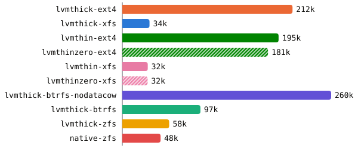
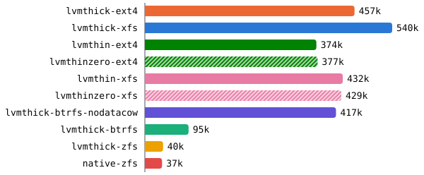
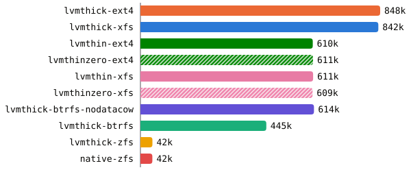
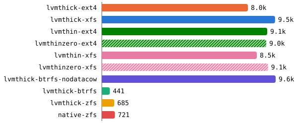
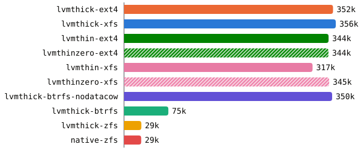
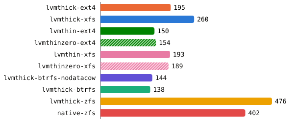
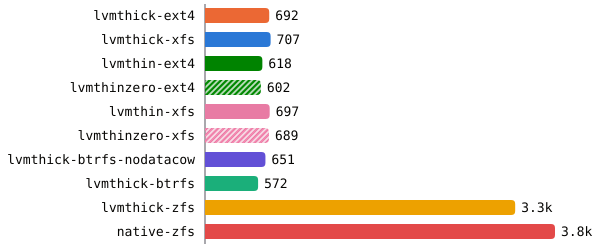
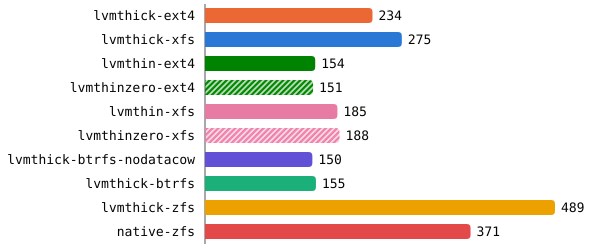
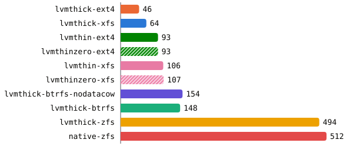
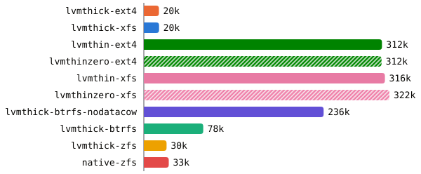

A disaster recovery setup is evaluated on two metrics. The recovery point objective
(RPO) is how much data you can afford to lose, measured as the time between the
last good backup and the failure. The recovery time objective (RTO) is how long
it takes to get back up and running after a failure.

Our goal was point-in-time recovery, with an RPO we can configure for the
entire cluster and near-zero RPO for databases. Every backup had to be
encrypted, and we wanted an RTO under an hour if we lose the whole cluster.
Everything also had to be infrastructure as code, so the whole setup is
reproducible and can be reused on different sites and on client clusters.

Our Kubernetes clusters run on bare-metal nodes instead of a managed cloud
service. That gives us full control to tune the infrastructure to our own
workloads, costs less, and avoids vendor lock-in. But that also means there's
no cloud provider underneath to hand out one-click snapshots and a recovery
plan. This post walks through how we built disaster recovery for these clusters.

## Table of contents

## Picking a snapshot layer for PVs

Kubernetes can ask for a volume snapshot through CSI, but it cannot take one
itself. Something below the PV, a volume manager or a copy-on-write
filesystem, has to freeze the volume at one instant and keep that copy around
while the app keeps writing. Whatever layer is picked sits under every PV in
the cluster, so the candidates were benchmarked before choosing one.

We wrote a script that runs fio against throwaway volumes on a fresh server
with nothing else running on it. It covers ext4 and XFS on LVM with thick and
thin snapshots, and btrfs on a thick LV and ZFS on both a thick LV and the raw
drives, using their native snapshots. Each case ran once.
native-zfs ran afterwards on the same server, reinstalled with the pool
directly on the drives.

| Machine | Hetzner AX52                                                  |
| ------- | ------------------------------------------------------------- |
| CPU     | AMD Ryzen 7 7700 (8 cores, 16 threads)                        |
| Disks   | 2x Samsung PM9A1 1 TB (MZVL21T0HCLR)                          |
| OS      | NixOS 26.11 (Zokor)                                           |
| Kernel  | 6.18.59                                                       |
| LVM     | 2.03.41                                                       |
| ZFS     | OpenZFS 2.4.4                                                 |
| fio     | 3.42, `libaio`, `direct=1`                                    |

Thirteen cases were tested.

- **lvmthick-raw / lvmthin-raw**, the LV itself with no filesystem on top
- **lvmthick-ext4 / lvmthick-xfs**, ext4 or XFS on a thick LV, which is what
  the PVs ran on before
- **lvmthin-ext4 / lvmthin-xfs**, the same on a thin LV
- **lvmthinzero-raw / lvmthinzero-ext4 / lvmthinzero-xfs**, the three thin
  cases again with the pool's zeroing on. The other thin cases have it off
- **lvmthick-btrfs / lvmthick-btrfs-nodatacow**, btrfs on a thick LV, either
  with default options or mounted with `nodatacow`, which also turns off
  checksums and compression for the data
- **lvmthick-zfs**, a pool on a thick LV with `recordsize=16k` and lz4, and
  `primarycache=metadata` so that ZFS's RAM cache does not serve reads the
  other cases have to take from disk
- **native-zfs**, a dataset with the same settings on a pool striped straight
  across the two NVMe drives, with no mdadm or LVM underneath. The pool also
  holds the server's root filesystem

On a filesystem the tests run against a 16 GiB file that is allocated but
never written, so the first pass still writes into new space. The page cache
is dropped before every test. The snapshot is an LVM snapshot of the LV (with
the filesystem frozen while it is taken), a read-only btrfs subvolume
snapshot, or a ZFS snapshot.

Each case runs the same tests in this order.

| #   | Test              | fio                                         | What it measures                           |
| --- | ----------------- | ------------------------------------------- | ------------------------------------------ |
| 1   | randwrite-first   | 4k randwrite, qd32 x 4 jobs, one full pass  | writes into unallocated space              |
| 2   | randwrite-rewrite | same pass again                             | writes into already-allocated space        |
| 3   | fsync16k          | 16k randwrite, qd1, `fdatasync` every IO    | database-style commit latency              |
| 4   | randread          | 4k randread, qd32 x 4 jobs                  | read path through the mapping              |
| 5   | seqwrite          | 1M write, qd8                               | streaming throughput                       |
| x1  | randrw8k          | 8k random, 70% reads, qd16 x 4 jobs         | Postgres-style mixed IO                    |
| x2  | syncwrite         | 4k randwrite, `O_SYNC`, qd1 x 8 jobs        | parallel committers                        |
| x3  | walsync           | 16k sequential writes, `fdatasync` every IO | WAL-style appends (filesystems only)       |
| 6   | fsync16k-snap     | test 3 after taking a snapshot              | commits while a backup snapshot exists     |
| 7   | randwrite-snap    | test 1 after test 6, snapshot still there   | a full pass that breaks every shared block |
| x4  | syncwrite-snap    | x2 after test 7                             | parallel committers after test 7           |

By the time the snapshot is taken every block of the region has been written,
so every block is shared with it, and the first write to each one has to copy
it (a COW exception on thick, a chunk break on thin). Tests 6 and 7 are what
applications go through while a snapshot exists. x4 runs
after the full pass of test 7 has already broken all sharing, so it measures
much the same thing as x2, and is left out of the charts.

## Results

These charts compare ext4 and XFS on thick and thin LVs with btrfs and ZFS, one
test at a time, with the hatched bars showing thin with zeroing on. The first
eight tests ran without a snapshot.

### randwrite-first

<figure>

<figcaption>A full 4k random-write pass into space nothing has written yet.</figcaption>
</figure>

XFS converts an unwritten extent on almost every write into the preallocated
file, which is why it lags so far behind ext4 here. On this pass the filesystem's own allocation is the bottleneck, which
hides the cost of thin. It is also the only pass where zeroing costs anything,
since the pool wipes a chunk only the first time it is allocated. btrfs and
ZFS pay for copy-on-write and checksums on every write.

### randwrite-rewrite

<figure>

<figcaption>The same pass again, now into allocated space.</figcaption>
</figure>

With the extents already converted, XFS no longer pays for them. A thin LV has
to look up the chunk mapping on every IO. btrfs allocates new space on every
write anyway, so the second pass is no easier for it. On ZFS each 4k write has
to read and rewrite the 16k record it lands in.

### randread

<figure>

<figcaption>4k random reads.</figcaption>
</figure>

Reads on a thin LV go through the same chunk mapping. ZFS has
`primarycache=metadata`, so every read goes to the drives, and each 4k read
fetches and checksums a whole 16k record.

### seqwrite

<figure>

<figcaption>Streaming 1M writes, in MiB/s.</figcaption>
</figure>

The drives' throughput sometimes dropped for part of this test and the next,
whichever layer was on top, so small gaps between cases here are noise.

### randrw8k

<figure>

<figcaption>Mixed 8k random IO, 70% reads, with read IOPS shown.</figcaption>
</figure>

Mixed IO combines the costs of the random reads and writes above.

### fsync16k

<figure>

<figcaption>Single-threaded <code>fdatasync</code> commits per second.</figcaption>
</figure>

All of the commit tests are bound by the drive's flush. The PM9A1 is a client
drive without power-loss protection, so a flush has to actually reach the
NAND. A raw LV needs one flush per commit, while ext4 and XFS also commit
their journal. On thin, commits only slow down once a filesystem is on top.

ZFS only has to write the change to its intent log. The write itself lands in
memory, and ZFS only puts it in its final place in the next batch of writes, a
few seconds later. So a commit costs one small log write and one flush, close
to what a raw LV pays. The price is that without a separate log device, every
committed block is written to the same drives twice, once to the intent log
and once more in that batch.

### syncwrite

<figure>

<figcaption>8 parallel <code>O_SYNC</code> writers.</figcaption>
</figure>

On ZFS, parallel committers can share a single log write and flush.

### walsync

<figure>

<figcaption>WAL-style 16k appends with an <code>fdatasync</code> after each.</figcaption>
</figure>

Appends behave like the single-threaded commits. ZFS with the pool straight on
the drives behaves the same as on mdadm and LVM, so those are not what holds it
back.

### fsync16k-snap

<figure>

<figcaption>Single-threaded <code>fdatasync</code> commits with a snapshot present.</figcaption>
</figure>

ZFS never overwrites a block in place, so a snapshot only decides whether an
old block is freed or kept, and adds no copy to the write path. btrfs is
copy-on-write too. On a thick LV the write copies the old block before it
completes. On a thin LV the write stays fast and the flush grows instead,
likely the pool committing metadata for the chunks it just broke.

### randwrite-snap

<figure>

<figcaption>A full random-write pass with the snapshot still there, breaks every block it shares.</figcaption>
</figure>

On a thick LV every first write to a block has to copy the original into the
COW store and update the exception table before it can complete. Thin breaks
sharing once per 512 KiB chunk in the pool instead. btrfs-nodatacow has to copy
on write once per shared extent.

That makes ZFS a strong fit for commit-heavy databases, but it gives up an
order of magnitude on everything else. btrfs-nodatacow keeps up with thin LVM
only by turning off what btrfs is for.

## Thick of it

We decided to go with LVM thin when we need local snapshots, and LVM thick when
we use application-specific backups, mostly for databases.

> [!NOTE]
> HA PVs also sit on top of LVM, but they are served over
> [NVMe-oF](https://nvmexpress.org/specification/nvme-of-specification/) and
> use higher-level snapshots instead of LVM snapshots.

- LVM thin outperforms btrfs and ZFS in most of the tests. And it gives cheap
  snapshots, the one feature that is really needed.
- Thin snapshots are O(1) to take and reserve nothing, where a thick one
  reserves the volume's full size by default.
- While a backup is running, thin with a filesystem on top is about 16x faster
  on random writes than thick and does 1.7 to 2x the commits, and apps keep
  writing during every backup.
- In exchange, without a snapshot, thin loses up to 28% of random IOPS, at
  rates the workloads never reach, and up to 34% on commits.

The thin pool uses 512 KiB chunks, which match the mdadm chunk
size, and kept zeroing on. Zeroing only costs anything when a chunk is first
allocated. On the first random-write pass it cut lvmthin-raw from 622k to
about 502k IOPS and lvmthin-ext4 by 7%, left lvmthin-xfs unchanged, and every
other test stayed within run-to-run noise. Without it, a newly
allocated chunk is not wiped, so a partial write leaves whatever the previous
owner of those blocks wrote readable in the rest of the chunk, and the PVs
belong to unrelated apps.

The pool is declared in the NixOS [disko](https://github.com/nix-community/disko)
config alongside the rest of the volume group.

```nix
disko.devices.lvm_vg.vg1 = {
  type = "lvm_vg";
  lvs.vg1_thinpool = {
    size = "512G";
    lvm_type = "thin-pool";
    extraArgs = [ "--chunksize" "512k" "--zero" "y" ];
  };
};
```

## Putting it all together

- [OpenEBS LocalPV LVM](https://github.com/openebs/lvm-localpv) provides the
  PVs, as plain LVs carved out of a volume group on each node.
- [Velero](https://velero.io) takes CSI snapshots of those PVs, databases
  excluded, and, with
  [CSI snapshot data movement](https://velero.io/docs/main/csi-snapshot-data-movement/),
  uploads the snapshot contents to an object store.
- Databases are excluded from Velero and use application-specific streaming or
  continuous logical backups instead. That keeps backups smaller, which matters
  most for S3 and ClickHouse, and brings the RPO close to zero, which matters
  most for Postgres.
- Every backup is encrypted before it leaves the cluster. pgBackRest encrypts
  Postgres backups natively, and Kopia encrypts the PV data Velero uploads.
  Velero's cluster resources and ClickHouse backups go through a transparent
  S3 encryption proxy, which encrypts them on the way to the S3 provider.
- The object store is an S3 provider
  ([Backblaze B2](https://www.backblaze.com/cloud-storage)), so the backups
  live off the cluster and off Hetzner.

<figure>
![Backup architecture. Two NVMe drives sit under an mdadm array and an LVM volume group, which holds a thin pool for snapshot-backed PVs and thick LVs for the databases. OpenEBS serves them through the mayastor, lvm-thin and lvm-thick StorageClasses, with Mayastor backed by the thin pool. Velero uploads cluster resources through an S3 encryption proxy and PV snapshots through its Kopia data mover. Postgres (CloudNativePG with pgBackRest), SeaweedFS (filer.backup) and ClickHouse (clickhouse-backup with an S3 encryption proxy) are backed up by tooling in their umbrella charts. Everything is encrypted before it reaches the S3 provider.](assets/architecture.svg)
<figcaption>How backups flow from the drives to the S3 provider.</figcaption>
</figure>

### What stays out of Velero

Velero backs up most of the cluster. Applications like ClickHouse and
SeaweedFS are backed up with their own tooling instead. They hold by far the
largest datasets in the cluster, and they can grow insanely big, since
analytics tables in ClickHouse and object storage in SeaweedFS, which also
hosts the OCI registry, only ever accumulate. Both replicate their data inside
the cluster too, so a Velero backup would upload every replica of the same
data and multiply an already huge dataset in the S3 provider.

### How databases are handled

The Postgres setup uses [CloudNativePG](https://cloudnative-pg.io), with
backups done by [pgBackRest](https://pgbackrest.org). It archives every WAL
segment to the object store as soon as the segment is complete, and takes
periodic base backups on top. A restore replays the WAL over the nearest base
backup, so it can recover to any point in time, not only to the last backup.
pgBackRest also encrypts the repository natively, so base backups and WAL are
already encrypted when they leave the cluster.

SeaweedFS is backed up with `weed filer.backup`. It follows the filer's
metadata log and copies each file to the backup sink as it is created or
changed, so the backup trails the live data by seconds.

The [Altinity](https://altinity.com) ClickHouse setup is backed up with
[clickhouse-backup](https://github.com/Altinity/clickhouse-backup). ClickHouse
never changes a data part once it is written, so the tool freezes the tables,
which hardlinks their current parts without copying anything, and uploads
those. Incremental backups only upload the parts the previous backup does not
have, which keeps the ever-growing analytics tables cheap to back up.
clickhouse-backup does not encrypt what it uploads, so it talks to the S3
provider through an S3 encryption proxy running as a sidecar, which encrypts
every object on the way out.

### Why not Kopia file system backup

Velero can also back up volumes without snapshots, through its
[file system backup](https://velero.io/docs/main/file-system-backup/), which
runs Kopia against the live volume mounted in the pod. It works on any storage,
but the result is not a consistent state of the volume. Kopia copies each file
at a different moment while the app keeps writing, so Postgres would get data
files from different points in time, out of sync with the WAL. A snapshot
freezes the whole volume at one instant, so restoring it is like booting after
a power cut, which Postgres knows how to recover from.

Kopia is still involved, since the data mover uses it to upload snapshot
contents to the S3 provider, but there it reads from a frozen snapshot.

### Encrypting Velero backups

A Velero backup has two parts. The PV contents go through the data mover into
a Kopia repository, and Kopia encrypts everything it writes with the
repository password, so that data is encrypted before it leaves the cluster.
The cluster resources, the manifests Velero exports from the API server, are
uploaded as a tarball by Velero itself, which has no native encryption for
them yet. Client-side encryption is being worked on in
[velero-io/velero#9054](https://github.com/velero-io/velero/pull/9054). Until
it lands, Velero uploads cluster resources through a transparent S3 encryption
proxy, which encrypts them before they reach the S3 provider.
